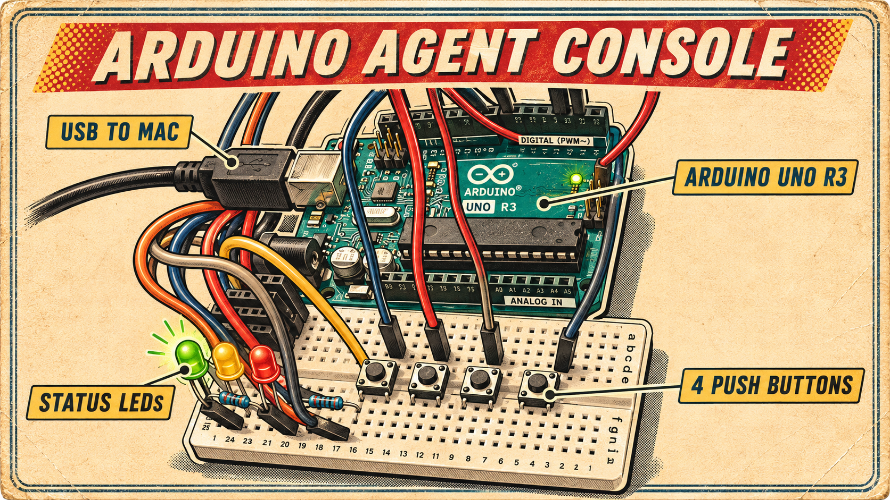
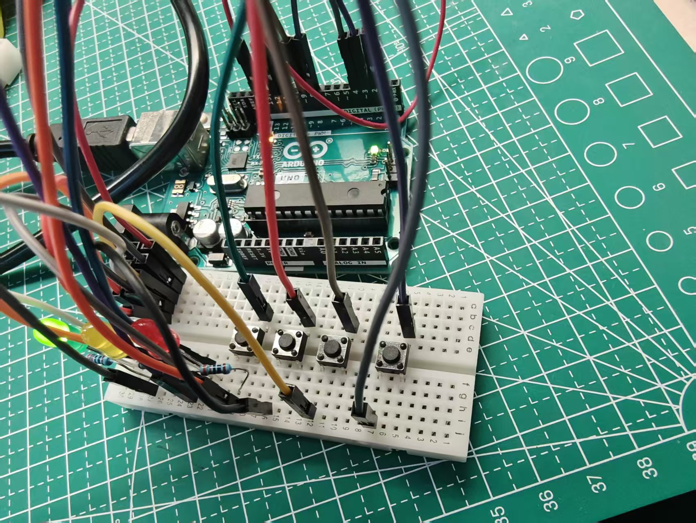
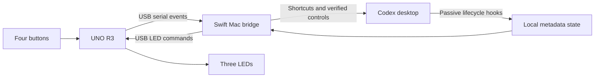

# Arduino Agent Console

Four physical buttons and three task lights for working with a desktop coding agent.

[中文说明](README.zh-CN.md) · [Build guide](docs/getting-started.md) · [Hardware](docs/hardware.md) · [Downloads](https://github.com/maozexi103-rgb/arduino-agent-console/releases/latest) · [Project page](https://maozexi103-rgb.github.io/arduino-agent-console/)



An Arduino UNO R3 reads four buttons. A small native macOS bridge maps them to Codex dictation, new chat, cancel/clear, and Dot live voice. Passive Codex lifecycle hooks send real task state back to the LEDs over the same USB connection.

The Arduino handles physical input and output. **Mac/Codex handles audio, transcription and AI. You review the draft and send it yourself.** No separate speech API key is needed by this bridge.

## What it does

| Button | Pin | Action |
|---|---|---|
| 1 | D8 | Start dictation, press again to stop. Text stays unsent for review. |
| 2 | D9 | Bring Codex forward and open a new chat in your configured project. |
| 3 | D11 | Cancel active dictation and discard it, or clear an unsent draft. |
| 4 | D12 | Start/end the native Dot live voice call. |

| Light | Pin | Meaning |
|---|---|---|
| Yellow | D3 | The selected main task is running. |
| Red | D2 | Waiting for an answer, choice or permission, or a bridge fault. |
| Green | D4 | The turn ended or the console is idle. **It does not mean the output is correct.** |
| Short red blink | D2 | State unknown, app unavailable or USB host timeout. |

Only the most recently submitted **main task** controls task lights. Older chats and subagents do not select a different task.

## See the hardware



[Watch the 28-second hardware demo](docs/assets/button-demo.mp4). It shows button actions on the physical prototype. Desktop outcomes were confirmed separately through logs and user acceptance. The clip has no audio. Its early button-test light colors do not validate lifecycle hooks.

The comic above is a photo-based AI illustration. The photograph and wiring guide document the hardware.

## Build it

You need an UNO R3, a 30-row breadboard, four normally open switches, red/yellow/green LEDs, **three 220 Ω resistors**, jumpers, and a USB data cable. [Parts list](hardware/bom.csv).

1. **Wire the board.** Follow the [overview and exact hole table](docs/hardware.md). Buttons connect to GND with `INPUT_PULLUP`. Each LED has its own series resistor.
2. **Upload firmware.** Open `firmware/voice_console/voice_console.ino` in Arduino IDE, select **Arduino UNO**, choose your port, and upload. Close other serial tools first.
3. **Build the Mac app.** Install Apple's Command Line Tools, then run:

   ```bash
   bash macos/build.sh
   ```

   This compiles, ad-hoc signs and self-tests `dist/Arduino Voice Bridge.app`. The self-test never opens the serial port or posts input.
4. **Configure the project.** Copy `macos/config.example.json` to `~/Library/Application Support/ArduinoVoiceBridge/config.json`. Edit the absolute paths, or remove optional keys to use discovery/defaults. [Configuration details](docs/getting-started.md#3-configure-the-target-and-project).
5. **Set up Codex controls and Accessibility.** Configure **Clear prompt** as `Ctrl+Option+Shift+Backspace`. Verify `Cmd+Shift+D` dictation and `Ctrl+Shift+V` live voice on your installed app. Launch the bridge and grant it Accessibility in macOS System Settings.
6. **Install task observers.** Preview and then install:

   ```bash
   python3 tools/install_agent_hooks.py
   python3 tools/install_agent_hooks.py --install
   ```

   Review the **seven new definitions** through Codex Settings → Hooks, or `/hooks`. The installer preserves other hooks and never changes trust hashes. Until trusted events arrive, the state remains unknown.
7. **Check the whole loop.** New chat, dictate, review, send manually, answer an agent question, and observe yellow/red/yellow/green. [Acceptance procedure](docs/testing.md).

For first-time builds, use the full [step-by-step guide](docs/getting-started.md). It includes recovery and uninstall instructions.

## How it works



- Firmware: 115200 baud, independent 30 ms button debounce, command ACKs, 8-second host timeout.
- Bridge: independent key counts, 500 ms suppression of fast accidental repeats, foreground checks and bounded cancellation targets.
- Observer: only `UserPromptSubmit` selects a main task. Async questions stay waiting until a real user submission. Metadata files use atomic writes and process locks.
- Protocol compatibility names such as `RECORDING` are **electrical color codes**, not proof that a recording or an agent task is active. [Architecture and protocol](docs/architecture.md).

## Compatibility and limits

This is an experimental desktop integration, not a universal keyboard or an official OpenAI product.

- Original hardware acceptance: UNO R3, macOS 26.3, Codex desktop `26.1111.21308`, 2026-11-17. Public release `0.5.1` adds configurable paths and serial selection. Its build and automated checks are separate from that physical acceptance.
- macOS deployment target is 13.0. The packaged app is **Apple Silicon arm64**, locally built and ad-hoc signed, not notarized. Build from source for your Mac. Other OS versions/architectures have not received physical acceptance.
- Hooks, shortcut names and accessibility labels can change. The main-thread filter reads selected metadata columns in local `state_*.sqlite` **read-only**. If the schema is unavailable, it ignores the event. This is an internal, version-sensitive dependency.
- B1/B3 require Codex in front. B2/B4 can bring it forward. Changing dictation outside the physical button can desynchronize the bridge; finish recording manually before using the reset menu.
- Dot call state is verified by the person using Codex, not automatically read by the bridge.
- Actual permission-wait events have not been accepted on hardware. Their mapping has regression coverage. No measured productivity increase or usability comparison is claimed.

## Test without hardware

```bash
python3 -m unittest discover -s tools -p 'test_*.py' -v
python3 -m unittest discover -s tests -p 'test_*.py' -v
python3 tools/check_release.py
bash macos/build.sh  # macOS only, pure self-test runs after compilation
```

To compile only, without touching a connected board:

```bash
arduino-cli core install arduino:avr@1.8.8
arduino-cli compile --fqbn arduino:avr:uno firmware/voice_console
```

## Repository map

```text
firmware/voice_console/  UNO sketch
macos/                  Native Swift bridge, Info.plist, local config example
tools/                  Passive observer, hook installer, release checks
tests/                  Wiring and installer portability regressions
hardware/               Exact wiring JSON and bill of materials
docs/                   Build guide, architecture, privacy, tests, build journal
docs/assets/            Hardware media, PNG and editable SVG wiring diagram
.github/workflows/      Python, AVR and macOS build checks
release/                Versioned release notes
```

[Troubleshooting](docs/troubleshooting.md) · [Privacy](docs/privacy.md) · [Build journal](docs/build-journal.md) · [Contributing](CONTRIBUTING.md) · [Reference projects](docs/references.md)

## License

Original code, documentation and original project assets are distributed under the [MIT License](LICENSE). Third-party tools, product names and trademarks retain their own terms. [Notices](THIRD_PARTY_NOTICES.md).
