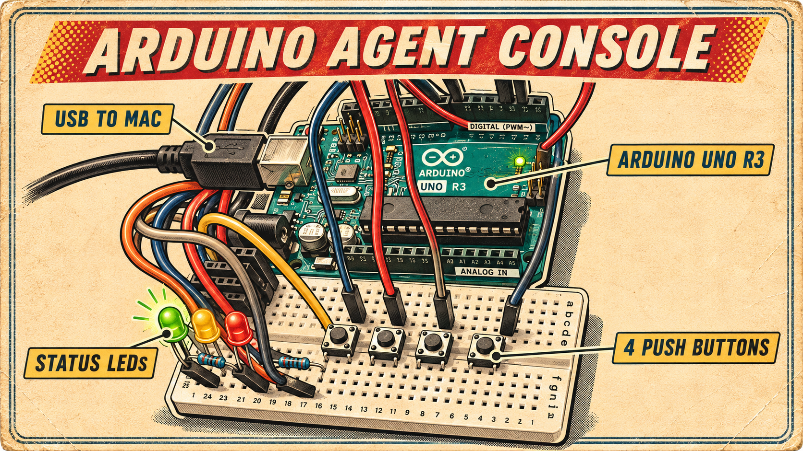
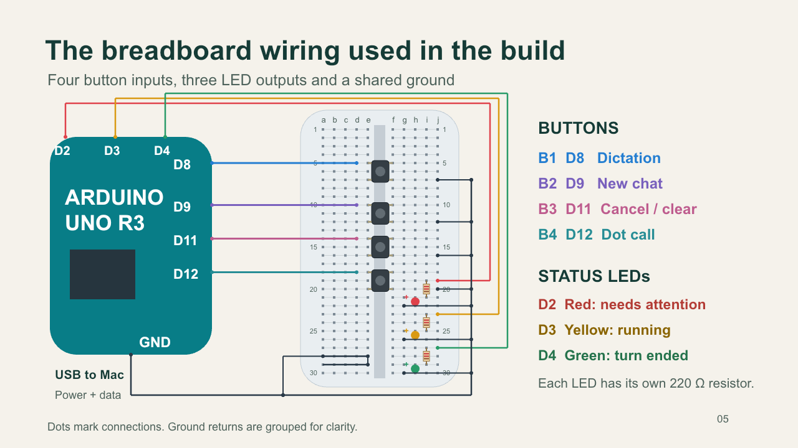

# Arduino Agent Console

用四个实体按钮指挥桌面编码 Agent，用三盏灯观察真实任务状态。

[English](README.md) · [项目展示页](https://maozexi103-rgb.github.io/arduino-agent-console/) · [下载与发布说明](https://github.com/maozexi103-rgb/arduino-agent-console/releases/latest)

UNO R3 读取按钮，经 USB 把事件交给 Mac 上的 Swift 桥接程序。桥接调用 Codex 的语音输入、新建对话、取消/清空与 Dot 通话。Codex 的任务 hooks 将真实任务状态送回 Arduino，驱动红黄绿灯。

**Arduino 负责实体输入输出；麦克风、转写和 AI 由 Mac/Codex 处理。文字先留在输入框，由人检查并手动发送。** 桥接不需要另外配置语音 API Key。

## 四键三灯

| 按钮 | 引脚 | 功能 |
|---|---|---|
| B1 | D8 | 开始听写，再按结束，转写后不自动发送 |
| B2 | D9 | 唤回 Codex，新建配置项目中的对话 |
| B3 | D11 | 取消当前听写并丢弃，或清空未发送草稿 |
| B4 | D12 | 接通/挂断 Dot 原生实时语音通话 |

| 灯 | 引脚 | 含义 |
|---|---|---|
| 黄 | D3 | 最近提交的主任务正在工作 |
| 红 | D2 | 等待回答、选择或权限，或者桥接故障 |
| 绿 | D4 | 本轮结束或空闲，**不代表结果正确** |
| 红短闪 | D2 | 状态未知、应用不可用或主机通信超时 |

## 从零复现

1. 准备 UNO R3、30行面包板、四个轻触按钮、红黄绿LED各一颗、三个220Ω电阻、跳线和USB数据线。[采购清单](hardware/bom.csv)。
2. 按[硬件接线页](docs/hardware.md)连接。按钮跨中央沟槽，按下接地；每颗灯独立串联电阻，所有支路共地。没有独立5V分线需求。
3. Arduino IDE打开 `firmware/voice_console/voice_console.ino`，选Arduino UNO和正确串口，上传。桥接或串口监视器需先退出。
4. 安装Apple命令行工具，在仓库根运行 `bash macos/build.sh`。产物在 `dist/Arduino Voice Bridge.app`，构建后会执行不操作硬件的自检。
5. 将 `macos/config.example.json` 复制到 `~/Library/Application Support/ArduinoVoiceBridge/config.json`，设置自己的项目目录、应用路径和串口。三个字段都可省略，使用默认发现。示例值必须修改或删除，不能原样当作实际配置。
6. 在Codex设置中，把“清除提示”设为 `Control+Option+Shift+Backspace`，确认 `Command+Shift+D` 能切换听写、`Control+Shift+V` 能切换通话。启动桥接并在macOS辅助功能中授权。
7. 先运行 `python3 tools/install_agent_hooks.py` 查看变更，再加 `--install` 安装。到Codex设置的Hooks页面或CLI的 `/hooks` 审核七条定义。脚本保留原有hooks，不修改信任hash。
8. 实测B1/B2/B3/B4及真实任务的黄→红→黄→绿。不要只看日志就认定录音已停止；检查实际界面。[完整安装](docs/getting-started.md)及[验收步骤](docs/testing.md)。

[可编辑SVG](docs/assets/wiring.svg) · [精确孔位JSON](hardware/wiring.json) · [28秒硬件演示](docs/assets/button-demo.mp4)

演示只展示硬件按压，电脑端功能来自独立日志与使用者验收。漫画是实物照片的AI风格化插图，不能当作精确接线依据。

## 已完成与边界

- 原型四键功能及真实工作、提问等待、恢复、结束灯效已验收。
- 原始硬件环境：macOS 26.3、Codex桌面 `26.1111.21308`、UNO R3。公开版 `0.5.1` 增加可移植配置，构建和回归通过不等于在新设备上重新做过硬件验收。
- macOS部署目标13.0；下载的桥接是本机编译的Apple Silicon arm64版本，ad-hoc签名、未公证。Intel机器请自行编译，其他系统未移植。
- 任务筛选会只读Codex本机SQLite中的线程元信息，依赖内部表结构，应用更新后可能需要调整；无法确认主线程时忽略事件。
- 真实权限请求分支尚未在硬件上出现，只有映射与回归覆盖。绿灯不保证AI正确，没有效率提升的实测数据。
- 工具自身不记录音频、转写或聊天正文。本机元信息日志仍可能包含路径和会话ID，分享日志前需检查。[隐私](docs/privacy.md)。

## 开源内容

本仓库公开当前固件、Mac源码、构建脚本、hooks观察器、安装/卸载工具、接线图源文件、BOM、自动检查及经过整理的开发过程。

历史本机日志、配置备份和原始聊天录屏没有作为源码发布。Codex服务和Arduino工具链本身不是本项目编写的软件，仍按各自条款使用。

[开发过程](docs/build-journal.md) · [架构与协议](docs/architecture.md) · [问题排查](docs/troubleshooting.md) · [参考方案](docs/references.md) · [MIT许可证](LICENSE)
