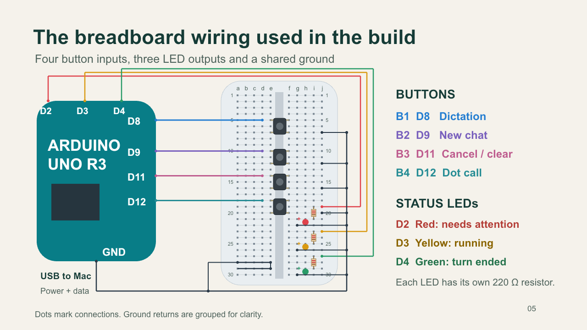

# Hardware and exact wiring

[BOM CSV](../hardware/bom.csv) · [Wiring JSON](../hardware/wiring.json) · [Editable SVG](assets/wiring.svg)

The overview expands UNO terminals by function. Black return wires represent one common GND node, grouped for readability. Only marked dots join crossing wires. For physical assembly use the following exact hole table.

## Breadboard orientation

Use a 30-row board with columns a–e on one side of the centre trench and f–j on the other. Each row's a–e holes connect together. That row's f–j holes connect separately. Neither half crosses the trench. The long power rails are unused.

Disconnect USB while wiring. Place switches across the trench using the listed four holes. Input and ground use opposite diagonal contacts so the intended circuit works with the two common internally paired four-pin layouts. Check your specific switch if its spacing differs.

## Buttons

| Button | UNO input | Four switch legs | Signal jumper | Ground jumper |
|---|---|---|---|---|
| B1 | D8 | e5, e7, f5, f7 | D8 → d5 | j7 → b28 |
| B2 | D9 | e10, e12, f10, f12 | D9 → d10 | j12 → c28 |
| B3 | D11 | e14, e16, f14, f16 | D11 → d14 | j16 → d28 |
| B4 | D12 | e18, e20, f18, f20 | D12 → d18 | j20 → a29 |

All four use `INPUT_PULLUP`: released HIGH, pressed LOW. Do not connect a button to 5V. D0/D1 stay free for serial.

## LEDs and resistors

Each resistor is **220 Ω**, in series. Anode is the long lead, cathode the short lead/flat-edge side on a new LED; verify polarity if leads were cut.

| LED | Drive jumper | Resistor endpoints | LED anode | LED cathode | Ground jumper |
|---|---|---|---|---|---|
| Red | D2 → j19 | i19 ↔ i21 | h21 | h22 | g22 → b29 |
| Yellow | D3 → j23 | i23 ↔ i25 | h25 | h26 | g26 → c29 |
| Green | D4 → j27 | i27 ↔ i29 | h29 | h30 | g30 → d29 |

Keep raised bare leads from touching. Ground links do not bypass a resistor.

## Common ground

1. UNO GND → a28.
2. Short jumper **e28 → e29** joins the two left-hand five-hole groups.
3. Place each button/LED return in its listed b28/c28/d28/a29/b29/c29/d29 hole.

No separate UNO 5V jumper is required. USB powers the board. D10 is reserved and held LOW, with no component required.

## What the lights mean

Yellow is running. Red is waiting for a response/permission or a bridge fault. Green is turn-ended/idle and does not certify output correctness. A short red blink indicates unknown/unavailable state. These meanings come from the Mac bridge and hooks, not from button press order.
